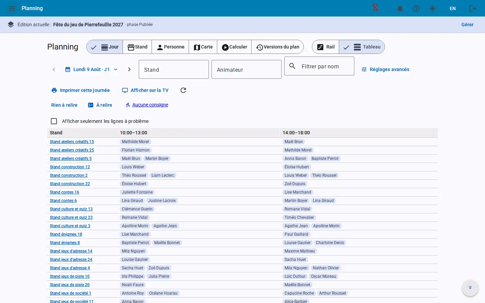

# Planning Équipes

[English](README.md) · **Français**

[](https://sonarcloud.io/summary/new_code?id=sylvainmetayer_planning-equipes)
[](https://sonarcloud.io/summary/new_code?id=sylvainmetayer_planning-equipes)
[](https://sonarcloud.io/summary/new_code?id=sylvainmetayer_planning-equipes)
[](https://sonarcloud.io/summary/new_code?id=sylvainmetayer_planning-equipes)
[](https://sonarcloud.io/summary/new_code?id=sylvainmetayer_planning-equipes)
[](https://sonarcloud.io/summary/new_code?id=sylvainmetayer_planning-equipes)
[](https://scorecard.dev/viewer/?uri=github.com/sylvainmetayer/planning-equipes)

Application de gestion de planning pour un événement : elle affecte
automatiquement les animateurs aux stands, en respectant le cadre légal
(notamment celui des mineurs), les compétences, les disponibilités et l'équité
de charge. Elle s'adresse aux organisateurs d'événements (festivals, salons,
manifestations sportives) qui gèrent une équipe de plusieurs dizaines de
personnes, bénévoles ou salariées, dont des mineurs.



Présentation, captures et contact : **[planning.sylvain.dev](https://planning.sylvain.dev/)**.

## Démarrage rapide

### Essayer (sans rien installer d'autre que Docker)

Il faut Docker (ou Podman) avec le plugin Compose. La pile de démonstration
télécharge l'image publiée, démarre PostgreSQL et un puits de courriels, et
n'écrit rien en dehors de ses volumes.

```bash
git clone https://github.com/sylvainmetayer/planning-equipes.git
cd planning-equipes
docker compose --profile app pull
docker compose --profile app up
```

Puis ouvrir <http://localhost:8080> et se connecter avec le compte `admin` et le
mot de passe que `docker-compose.yml` donne à `ADMIN_PASSWORD` (le choisir en
posant cette variable avant `up`). Les courriels que l'application envoie, dont
les codes d'accès de l'espace animateur, arrivent dans Mailpit sur
<http://localhost:8025>.

Premiers pas, sur une édition remplie :

1. **Fichiers**, onglet *Importer*, carte *Exemples* : choisir un exemple puis
   **Charger cet exemple**.
2. **Planning › Calculer › Calculer le planning** : le calcul tourne en fond, la courbe se
   trace en direct et une notification annonce la fin.
3. Lire le résultat dans **Planning**, ce qui bloque dans **Diagnostic**, le
   respect des règles dans **Règles du planning**, puis exporter depuis
   **Diffuser** ou depuis la fiche d'un animateur.

<kbd>Ctrl</kbd>+<kbd>K</kbd> trouve n'importe quel écran, et la page **Aide**
(icône « ? ») est le mode d'emploi complet.

⚠️ Cette pile est faite pour le poste de travail : elle publie PostgreSQL sur
l'hôte, ajoute pgAdmin sans authentification sur <http://localhost:5050> et
utilise des mots de passe d'exemple. Elle tourne sur l'image `main`, celle de
la recette. **Pour un déploiement accessible depuis Internet**, voir
[Installer l'application](site/src/docs/installer/installation.md).

### Développer

Prérequis : Java 25, Maven et Node, épinglés dans `mise.toml` et installables
d'un coup avec [mise](https://mise.jdx.dev) (`mise install`), et Docker ou
Podman pour la base. Node n'est requis que pour travailler sur le frontend : le
build Maven télécharge lui-même la version dont il a besoin.

```bash
docker compose up -d postgres     # la base seule
./mvnw quarkus:dev                # l'application sur http://localhost:8080
```

Le code Java comme le frontend Angular sont rechargés à chaud : Quarkus démarre
aussi le serveur de développement Angular et le proxifie, tout passe donc par
<http://localhost:8080>. Le compte est `admin`, mot de passe `admin` (variable
`ADMIN_PASSWORD`). Les tests : `./mvnw test`. Le détail (tests d'intégration,
Podman, réglages du solveur, CI) est dans
[`demarrer.md`](site/src/docs/comprendre/demarrer.md), [`tests.md`](site/src/docs/comprendre/tests.md), [`regler-le-solveur.md`](site/src/docs/comprendre/regler-le-solveur.md) et [`ci-et-livraison.md`](site/src/docs/comprendre/ci-et-livraison.md).

## Documentation

La documentation complète est publiée sur
**[planning.sylvain.dev/docs](https://planning.sylvain.dev/docs/)**, en trois
parties :

| Partie | Pour qui | Point d'entrée |
| --- | --- | --- |
| **Les règles du jeu** | L'organisateur, le bénévole responsable | [`site/src/docs/regles/`](site/src/docs/regles/index.md) |
| **Installer chez vous** | Qui héberge l'application | [`site/src/docs/installer/installation.md`](site/src/docs/installer/installation.md), [`site/src/docs/installer/variables-environnement.md`](site/src/docs/installer/variables-environnement.md) |
| **Comprendre comment c'est fait** | Qui développe ou audite | [`site/src/docs/comprendre/vue-d-ensemble.md`](site/src/docs/comprendre/vue-d-ensemble.md), [`site/src/docs/comprendre/demarrer.md`](site/src/docs/comprendre/demarrer.md) |

Les décisions d'architecture, les schémas et les diagrammes restent dans [`docs/`](docs/README.md). Le mode d'emploi
pas à pas est dans l'application, page « Aide ».

| Pour… | Voir |
| --- | --- |
| Les conventions suivies par les agents IA | [`AGENTS.md`](AGENTS.md) |
| Contribuer (checklist de PR) | [`.github/CONTRIBUTING.md`](.github/CONTRIBUTING.md) |
| Signaler une faille | [`.github/SECURITY.md`](.github/SECURITY.md) |
| Code de conduite | [`.github/CODE_OF_CONDUCT.md`](.github/CODE_OF_CONDUCT.md) |

---

## Licence

**AGPL-3.0-only** — voir [`LICENSE`](LICENSE) et [`NOTICE`](NOTICE).

Copyright (C) 2026 Sylvain METAYER (sylvain.dev).

Concrètement : le code est libre d'usage, y compris commercial, à condition que
toute version modifiée **mise à disposition sur un réseau** publie ses sources
sous la même licence (article 13 de l'AGPL). Héberger l'application pour ses
propres besoins n'impose rien de plus que de rendre disponible le code que l'on
fait tourner.

Les contributions sont acceptées sous cette licence — voir
[`.github/CONTRIBUTING.md`](.github/CONTRIBUTING.md).

## Assistance IA

Ce projet est développé avec l'assistance d'outils d'IA, sous revue humaine
systématique. Les choix d'architecture, le modèle de domaine et
l'interprétation du cadre légal sont assumés par l'auteur.
