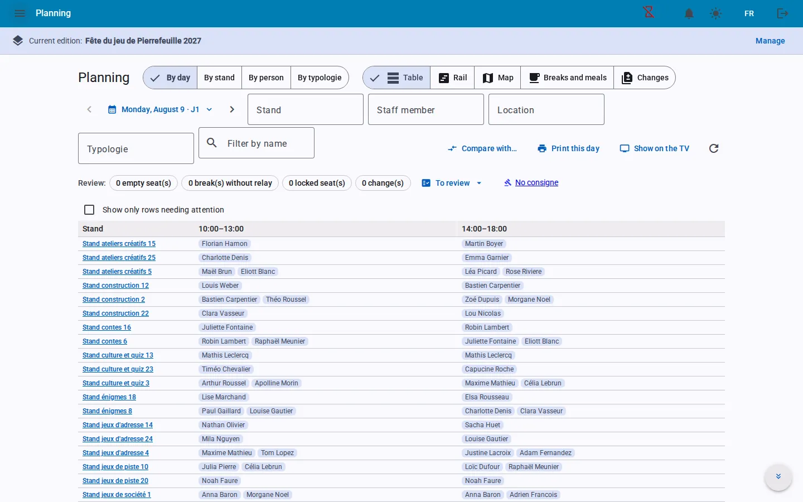

# Planning Équipes

**English** · [Français](README.fr.md)

[](https://sonarcloud.io/summary/new_code?id=sylvainmetayer_planning-equipes)
[](https://sonarcloud.io/summary/new_code?id=sylvainmetayer_planning-equipes)
[](https://sonarcloud.io/summary/new_code?id=sylvainmetayer_planning-equipes)
[](https://sonarcloud.io/summary/new_code?id=sylvainmetayer_planning-equipes)
[](https://sonarcloud.io/summary/new_code?id=sylvainmetayer_planning-equipes)
[](https://sonarcloud.io/summary/new_code?id=sylvainmetayer_planning-equipes)
[](https://scorecard.dev/viewer/?uri=github.com/sylvainmetayer/planning-equipes)

Schedule management for an event: it assigns staff members to stands
automatically, within the legal framework (minors in particular), skills,
availability and a fair share of the workload. It is meant for the organisers of
events (festivals, trade shows, sports events) who manage a team of several
dozen people, volunteers or employees, minors included.



Presentation, screenshots and contact: **[planning.sylvain.dev](https://planning.sylvain.dev/en/)**.

## Quick start

### Try it (nothing to install but Docker)

You need Docker (or Podman) with the Compose plugin. The demo stack pulls the
published image, starts PostgreSQL and a mail sink, and writes nothing outside
its volumes.

```bash
git clone https://github.com/sylvainmetayer/planning-equipes.git
cd planning-equipes
docker compose --profile app pull
docker compose --profile app up
```

Then open <http://localhost:8080> and sign in with the `admin` account and the
password `docker-compose.yml` gives to `ADMIN_PASSWORD` (pick your own by
setting that variable before `up`). The e-mails the application sends, access
codes of the staff espace included, arrive in Mailpit at
<http://localhost:8025>.

First steps, on a filled edition:

1. **Files**, *Import* tab, *Examples* card: pick an example, then
   **Load this example**.
2. **Solver › Solve**: the solve runs in the background, the curve is drawn
   live and a notification announces the end.
3. Read the result in **Planning**, what blocks in **Diagnostic**, how the rules
   are respected in **Planning rules**, then export from **Share** or from a
   staff member's profile.

<kbd>Ctrl</kbd>+<kbd>K</kbd> finds any screen, and the **Help** page ("?" icon)
is the complete user manual.

⚠️ This stack is made for a workstation: it publishes PostgreSQL on the host,
adds pgAdmin without authentication at <http://localhost:5050> and uses example
passwords. It runs the `main` image, the one under acceptance testing. **For a
deployment reachable from the Internet**, see
[Install the application](site/src/docs-en/install/installation.md).

### Develop

Prerequisites: Java 25, Maven and Node, pinned in `mise.toml` and installable
in one go with [mise](https://mise.jdx.dev) (`mise install`), and Docker or
Podman for the database. Node is only needed to work on the frontend: the Maven
build downloads the version it needs by itself.

```bash
docker compose up -d postgres     # the database alone
./mvnw quarkus:dev                # the application on http://localhost:8080
```

Both the Java code and the Angular frontend are hot-reloaded: Quarkus also
starts the Angular development server and proxies it, so everything goes
through <http://localhost:8080>. The account is `admin`, password `admin`
(variable `ADMIN_PASSWORD`). Tests: `./mvnw test`. The details (integration
tests, Podman, solver settings, CI) are in
[`getting-started.md`](site/src/docs-en/build/getting-started.md), [`tests.md`](site/src/docs-en/build/tests.md), [`tune-the-solver.md`](site/src/docs-en/build/tune-the-solver.md) and [`ci-and-delivery.md`](site/src/docs-en/build/ci-and-delivery.md).

## Documentation

The complete documentation is published at
**[planning.sylvain.dev/en/docs](https://planning.sylvain.dev/en/docs/)**, in
three parts (every page also exists in French, under
[planning.sylvain.dev/docs](https://planning.sylvain.dev/docs/)):

| Part | For whom | Entry point |
| --- | --- | --- |
| **The rules of the game** | The organiser, the lead volunteer | [`site/src/docs-en/rules/`](site/src/docs-en/rules/index.md) |
| **Install it yourself** | Whoever hosts the application | [`site/src/docs-en/install/installation.md`](site/src/docs-en/install/installation.md), [`site/src/docs-en/install/environment-variables.md`](site/src/docs-en/install/environment-variables.md) |
| **How it's built** | Whoever develops or audits | [`site/src/docs-en/build/overview.md`](site/src/docs-en/build/overview.md), [`site/src/docs-en/build/getting-started.md`](site/src/docs-en/build/getting-started.md) |

Architecture decisions, schemas and diagrams stay in [`docs/`](docs/README.md)
(in French). The step-by-step manual is in the application, "Help" page.

| To… | See |
| --- | --- |
| The conventions AI agents follow | [`AGENTS.md`](AGENTS.md) |
| Contribute (PR checklist) | [`.github/CONTRIBUTING.md`](.github/CONTRIBUTING.md) |
| Report a vulnerability | [`.github/SECURITY.md`](.github/SECURITY.md) |
| Code of conduct | [`.github/CODE_OF_CONDUCT.md`](.github/CODE_OF_CONDUCT.md) |

---

## Licence

**AGPL-3.0-only**: see [`LICENSE`](LICENSE) and [`NOTICE`](NOTICE).

Copyright (C) 2026 Sylvain METAYER (sylvain.dev).

In practice: the code is free to use, commercially included, provided that any
modified version **made available over a network** publishes its sources under
the same licence (article 13 of the AGPL). Hosting the application for your own
needs requires nothing more than making available the code you run.

Contributions are accepted under this licence: see
[`.github/CONTRIBUTING.md`](.github/CONTRIBUTING.md).

## AI assistance

This project is developed with the help of AI tools, under systematic human
review. The architecture choices, the domain model and the reading of the legal
framework are the author's own.
